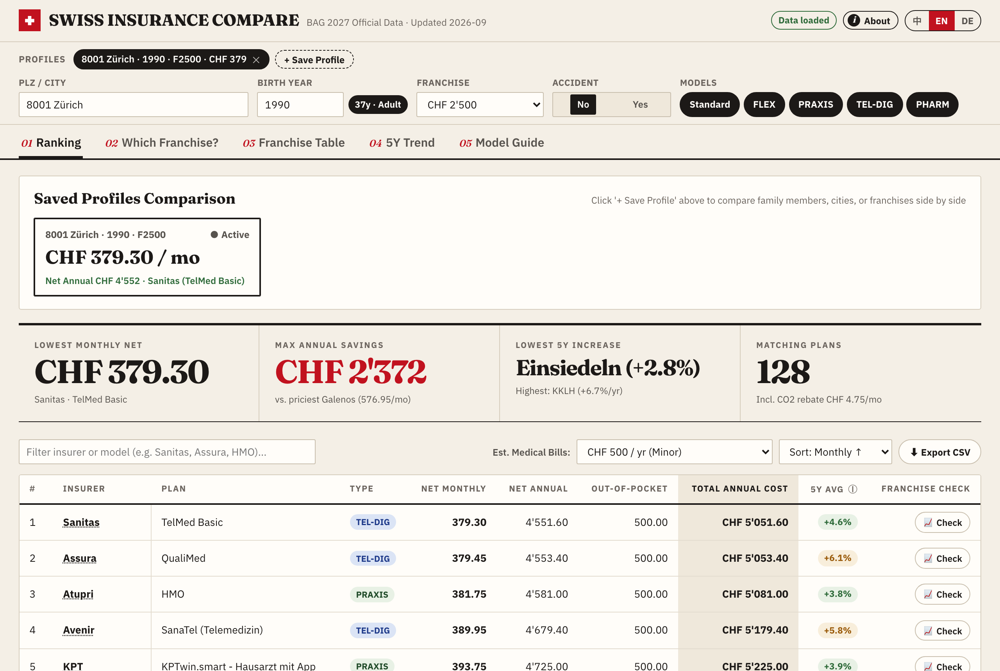
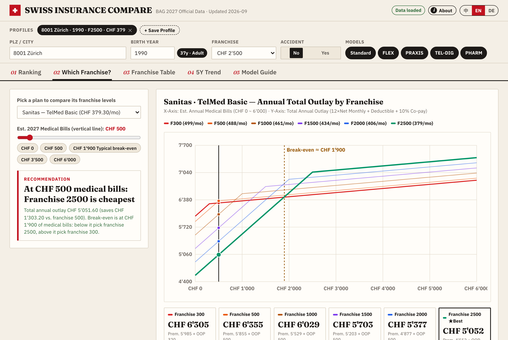

# Swiss Insurance Compare（瑞士基础医保比价）

[English](README.md) · **中文**

查询与对比 2027 年瑞士基础医疗保险（KVG / LAMal）全部方案保费，并根据你预期的年度医疗开支找出最划算的免赔额（Franchise）。

**线上地址：** https://swiss-insurance-compare.vercel.app · **姊妹项目：** [Swiss Tax Compare（瑞士税务计算比价）](https://swiss-tax-compare.vercel.app)（[GitHub](https://github.com/maxing-labs/swiss-tax-compare)）





Swiss Insurance Compare 是个人独立项目，与瑞士联邦公共卫生局（BAG / FOPH）无关。所有保费数据均实时取自官方计算器 [priminfo.admin.ch](https://www.priminfo.admin.ch) 并原样展示（BAG 亦在 [opendata.swiss](https://opendata.swiss) 发布相同开放数据）。计算结果仅供参考，不构成保险建议。

## 功能概览

- **方案排名（01 Ranking）：** 按所在地邮编列出全部可用医保方案，支持按月净保费或年度总支出（12 个月净保费 + 免赔额 + 10% 自付比例）排序与 CSV 导出。
- **免赔额决策曲线（02 Which Franchise?）：** 针对任一方案绘制不同免赔额档位随医疗开支变化的年度总支出曲线，直观标出盈亏平衡点（Break-even）。
- **免赔额全表（03 Franchise Table）：** 展示所有方案在全部免赔额档位下的完整保费矩阵。
- **五年走势（04 5Y Trend）：** 对比各保险公司过去 5 年的保费涨幅与历史曲线。
- **家庭档案对比：** 支持保存多位家庭成员的个人配置，并按保险公司汇总全家总保费。
- **多语言与隐私：** 支持英文、德文、中文界面；支持 URL 参数分享；无账号、无追踪，已保存的档案仅存储在浏览器本地。

## 本地运行与测试

项目**零外部依赖**：后端仅使用 Python 标准库，前端为原生 ES 模块（无构建步骤）。

```sh
python3 server.py                  # 启动本地服务：http://127.0.0.1:8765
python3 -m unittest                # 后端离线单元测试（使用 tests/fixtures/ 中的上游快照）
node --test 'tests/js/*.test.mjs'  # 前端单元测试（需 Node >= 22）
```

端到端浏览器测试位于 `tests/e2e/`（需本机具备 `playwright-core`），运行方式见 [AGENTS.md](AGENTS.md)。生产环境部署于 Vercel，由 `vercel.json` 将 `/api/*` 路由至 `api/index.py`、其余静态资源路由至 `static/`。

## 协作方式：由 Coding Agents 构建

与姊妹项目 [Swiss Tax Compare](https://github.com/maxing-labs/swiss-tax-compare)（[线上](https://swiss-tax-compare.vercel.app)）一样，本仓库迄今为止的每一次提交均由 AI 编程代理（Claude Code，跨多个串行与并行会话）编写。仓库特意完整保留了过程记录，方便查阅实际协作流程：

- [`AGENTS.md`](AGENTS.md) 是每个 Agent 进入仓库首先阅读的说明书：包含运行与测试方式、工程约定，以及每次会话结束必须留存记录的规则。
- [`.agents/docs/`](.agents/docs/) 存放按会话拆分的工程记录（`yymmdd-session-*.md`）：包含目标、完成内容与提交 hash、关键决策及原因（由人类拍板的标有「用户选」），以及遗留问题。[`261025-architecture-review.md`](.agents/docs/261025-architecture-review.md) 是确立后续迭代顺序的 P0/P1/P2 架构评审。
- 由 Agent 完成的提交信息末尾带有 `#vibe #claude`。

## 许可证

[MIT](LICENSE)。自托管字体 Fraunces 与 IBM Plex Sans 基于 SIL Open Font License 分发，详见 `static/fonts/`。
